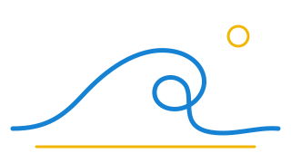

<div align="center">



# marola-research

<sub>since 2026 · the science of <a href="https://github.com/marola-dev/marola">marola</a> · <a href="https://marola-dev.github.io/marola-research/">the sites</a> · <a href="#researches">researches</a> · <a href="#a-new-paper-explained-like-you-are-five">a new paper</a> · <a href="#discipline-from-the-root-freedom-in-a-research">overrides</a> · <a href="#cite">cite</a></sub>

[](#history)
[](#researches)
[](https://doi.org/10.5281/zenodo.23352633)
[](https://github.com/marola-dev/marola-research/actions/workflows/pdf.yml)
[](https://github.com/marola-dev/marola-research/actions/workflows/md.yml)
[](https://github.com/marola-dev/marola-research/actions/workflows/links.yml)
[](https://github.com/marola-dev/marola-research/actions/workflows/site.yml)
[](#licence)

The science of [marola](https://github.com/marola-dev/marola). One directory is one research:
its paper, its sources, the log of how each source was checked, its notes, its journal, its
site and later its code. The discipline comes from the root; each research is its owner's.

marola-research was minted by the owner's other repositories: its rules came from
[closed-source](https://github.com/h0ffmann/closed-source),
[ww3-gpu](https://github.com/h0ffmann/ww3-gpu), [picasso](https://github.com/h0ffmann/picasso)
and [marola](https://github.com/marola-dev/marola) ([history](#history)).
</div>

## Researches

Each research is numbered as a marola experiment, in the order it was opened.

| Experiment | Research | What it is | Site | Paper | Status |
|---|---|---|---|---|---|
| `marola-experiment-001` | [`marola-bench`](marola-bench/README.md) | a WeatherBench for Brazil: Brazilian regions, wave variables, instruments as the truth | [marola-dev.github.io/marola-research/marola-bench](https://marola-dev.github.io/marola-research/marola-bench/) | [PDF](marola-bench/marola-bench.pdf), [source](marola-bench/paper/paper.md) | a proposal, v0.1.0, DOI [10.5281/zenodo.23352633](https://doi.org/10.5281/zenodo.23352633). No score has been computed |

**marola-bench is marola-experiment 001.** Later it will be filed as a case study of how
marola-research, the tool, improves itself. Each research tests the rules, the checks and the
skill of this repository. What a research finds goes back to the root. The study is not written
yet.

Not a research: [`chamada/`](chamada/README.md), *Marola: Chamada para CONTRIBUIÇÃO e
PUBLICAÇÃO* ([PDF](chamada/chamada.pdf), at most 5 pages). It is a call in easy Brazilian
Portuguese to undergraduates, master's and doctoral students. It says what marola is, and what
it takes to publish on marola.dev and to collaborate with it.

## A new paper, explained like you are five

Think of this repository as a school. The rulebook is on the front door, and every classroom
follows it: never make up a source, say how you checked each claim, credit whoever you learned
from. Each research is a classroom with its own teacher. The teacher picks the language, the
tools, the way of working and who may copy from the blackboard. The teacher cannot tear a page
out of the rulebook.

To open a classroom:

1. **Ask.** Open an issue in this repository with a name for your research, one sentence about
   it, and the licence you want. The owner of the repository opens the directory
   ([`AGENTS.md`](AGENTS.md), rule 4); from then on the research is yours.
2. **Make the parts.** Every research has the same parts (the tree below). Start with notes:
   one idea in one note ([`NOTES.md`](NOTES.md)).
3. **Write the paper from the notes.** Put a mark on every claim: `(v)` when you checked it,
   `⚠` when you did not. Write in `paper/REFERENCES.md` how you checked each source.
4. **Run the checks** on your machine, or let CI run them (below).
5. **Open a pull request.** CI renders the paper and checks it. A human merges it.
6. **Release** only when you ask the owner by name: a release makes a DOI, and a DOI cannot be
   deleted.

### The parts of a research

```text
<research>/
  README.md               what it is, its hard rules (yours), its status, its terms
  OVERRIDE_CONFIG.toml    what it changes of the root's discipline (optional)
  <research>.pdf          the rendered paper (`just paper <research>`)
  paper/
    paper.md              front matter, then the text, a mark on every claim
    refs.bib              every reference, with a DOI where one exists
    REFERENCES.md         one row for each entry of refs.bib: how it was checked
  notes/                  the slip box: index.md, then one note for each idea
  journal/                one entry for each challenge met
  site/                   its website, Gleam and Lustre, built from the files above
```

A `paper.md` starts like this, and its last two sections are always "What is not known" and
"Where the thesis comes from" ([`ouro-paper`](.claude/skills/ouro-paper/SKILL.md)):

```markdown
---
title: "<the title>"
author: "<you>"
status: draft
version: 0.1.0
date: 2026-10-14
related: []
style: research
---
```

## Discipline from the root, freedom in a research

All the discipline comes from the root of this repository: [`AGENTS.md`](AGENTS.md),
[`REUSE.md`](REUSE.md), [`TRADEMARKS.md`](TRADEMARKS.md), [`NOTES.md`](NOTES.md) and the
[`ouro-paper`](.claude/skills/ouro-paper/SKILL.md) skill. Every research starts with all of it.
Each researcher is free to set the licence of their research on their own terms, and to work in
their own way.

[`OVERRIDE_CONFIG.toml`](OVERRIDE_CONFIG.toml) at the root declares how much a research may
override, policy by policy. A research writes what it changes in its own
`<research>/OVERRIDE_CONFIG.toml`, and `just overrides` refuses what the root does not allow.

| Level | Policies | What a research may do |
|---|---|---|
| `free` | licence, workflow, language | set its own value, with the date and the files where a reader finds it |
| `stricter-only` | checks, parts | add a check or a part; never remove or loosen one of the root's |
| `never` | citation, trademarks, references, humans-steer, private-sources, isolation, branches, release | nothing: the root's rule holds as written |

marola-bench declares two overrides
([`marola-bench/OVERRIDE_CONFIG.toml`](marola-bench/OVERRIDE_CONFIG.toml)): its licence (all
rights reserved) and its workflow (its hard rules 1, 2, 3 and 7). A licence in
[`REUSE.toml`](REUSE.toml) that a research does not declare fails the check, and so does a
declared one that `REUSE.toml` does not give.

## Install it on your machine

You need Git, [Nix](https://nixos.org/) and [`just`](https://github.com/casey/just). Nix brings
every other tool, at the versions pinned in `flake.lock`. On Ubuntu 24.04:

```console
curl -fsSL https://install.determinate.systems/nix | sh -s -- install   # Nix (Determinate's installer)
sudo apt install just                                                  # just 1.21 reads this justfile
git clone https://github.com/marola-dev/marola-research && cd marola-research
just paper marola-bench    # marola-bench/paper/*.md -> marola-bench/marola-bench.pdf
just site marola-bench     # the research's files -> marola-bench/site/dist/
just pages                 # every research's site, as one tree for GitHub Pages
```

The first `just paper` downloads the toolchain; later runs reuse it. The scripts that check citations and overrides need Python 3.11 or later (Ubuntu 24.04
has 3.12).

<details>
<summary>Environment details</summary>

The tools come from [picasso](https://github.com/h0ffmann/picasso)'s labs, through
[`flake.nix`](flake.nix).

| Shell | From | Programs |
| :---- | :--- | :------- |
| default (`nix develop`) | picasso's `paper` lab | pandoc and citeproc, XeLaTeX, just, poppler, librsvg |
| `md` (`nix develop .#md`) | the `paper` lab's nixpkgs | markdownlint-cli2, Vale, lychee, reuse, git |
| `site` (`nix develop .#site`) | picasso's `gleam-website` lab | Gleam, Node, esbuild |

</details>

## With a Claude Project (not Claude Code)

A Claude Project is a project on claude.ai: a set of instructions, files and repositories that
every chat in it shares. You do not install anything. Claude reads the repository and the
rules, writes with you, and proposes the change as a pull request; CI runs the checks you would
run by hand.

1. **Make the project** on claude.ai, and add the repository `marola-dev/marola-research`. Add
   `h0ffmann/picasso` too: the flake reads its labs. marola's own project file records that a
   session got "403" from GitHub for a flake input outside the project's repositories
   ([`CLAUDE_PROJECT.config.md`](https://github.com/marola-dev/marola/blob/e208ae6/CLAUDE_PROJECT.config.md),
   section 2).
2. **Give it the rules.** Paste into the project instructions: "Read AGENTS.md, then the
   README.md of the research you work on, then .claude/skills/ouro-paper/SKILL.md. Work on a
   branch and open a pull request; never push to main."
3. **Say which research** you work on, and what you want: a note, a section, a reference to
   check.
4. **Read the pull request's checks.** When `pdf`, `.md` or `site` fails, paste the failure into
   the chat and ask for a fix. Do not ask it to skip a check.
5. **Read the PDF** that the pull request renders before you merge.

This way of working has not been tried yet with this repository. The steps come from marola's
project, which runs the same way.

## How to read a paper here

Every claim carries a mark: `(v)` was checked, and the paper's `REFERENCES.md` says how; `⚠`
was not. Every paper ends with what is not known.

## Checks

`just check <research>`, `just md-quality`, `just overrides` and `just pages` are what CI runs,
on each pull request and on `main`: [`pdf`](.github/workflows/pdf.yml) (one job for each
research), [`.md`](.github/workflows/md.yml), [`live links`](.github/workflows/links.yml) and
[`site`](.github/workflows/site.yml), which also publishes the sites from `main`.
[`AGENTS.md`](AGENTS.md) says what each one checks.

## For agents

[`AGENTS.md`](AGENTS.md) has the map and the rules;
[`ouro-paper`](.claude/skills/ouro-paper/SKILL.md) is how a text is written and checked. The
skill has no evals yet.

## History

marola-research was minted by the owner's other repositories. Its rules are theirs, each read
at a commit ([`ouro-paper`](.claude/skills/ouro-paper/SKILL.md), "Sources"):

| Repository | DOI | What it gave |
|---|---|---|
| [h0ffmann/closed-source](https://github.com/h0ffmann/closed-source) | [10.5281/zenodo.23333656](https://doi.org/10.5281/zenodo.23333656) | humans steer; never invent a reference; borrow, cite, propagate; the reference log; the easy pt-BR version |
| [h0ffmann/ww3-gpu](https://github.com/h0ffmann/ww3-gpu) | [10.5281/zenodo.23221351](https://doi.org/10.5281/zenodo.23221351) | the `(v)` and `⚠` marks; every number with its command; no result before parity |
| [h0ffmann/picasso](https://github.com/h0ffmann/picasso) | [10.5281/zenodo.23311208](https://doi.org/10.5281/zenodo.23311208) | a pinned toolchain (the labs this flake reads); `.zenodo.json` as the one hand-edited citation file; the shape of this README |
| [marola-dev/marola](https://github.com/marola-dev/marola) | [10.5281/zenodo.23224155](https://doi.org/10.5281/zenodo.23224155) | design first, in a MIP; the release chain; "a DOI cannot be deleted" |

| When | Pull requests | What happened |
|---|---|---|
| 2026-10-10 | none | the first commit |
| 2026-10-13 | [#2](https://github.com/marola-dev/marola-research/pull/2)–[#6](https://github.com/marola-dev/marola-research/pull/6) | one directory for each research; the `ouro-paper` skill; marola-bench, its site, notes and journal; its v0.1.0 and its DOI; other people's skills by link |
| 2026-10-14 | [#8](https://github.com/marola-dev/marola-research/pull/8), [#9](https://github.com/marola-dev/marola-research/pull/9) | marola-bench's hard rule 7 and its design in pictures; the call for contribution, `chamada/` |

## Cite

Each research that was released has its own DOI, and its page says how to cite it.

| Research | Cite the work | This version |
|---|---|---|
| marola-bench | [10.5281/zenodo.23352633](https://doi.org/10.5281/zenodo.23352633) | v0.1.0: [10.5281/zenodo.23352634](https://doi.org/10.5281/zenodo.23352634) |

> Hoffmann, M. (2026). *marola-bench: a proposal for a WeatherBench for Brazil*. Zenodo.
> <https://doi.org/10.5281/zenodo.23352633>

GitHub's "Cite this repository" gives the same, from [`CITATION.cff`](CITATION.cff).

## Skills by other people

This repository's own skill, [`ouro-paper`](.claude/skills/ouro-paper/SKILL.md), learned from
other people's skills for paper quality; [`REA.md`](.claude/skills/ouro-paper/REA.md) credits
each one at a commit, with its licence. The largest source is K-Dense's library:

> Kassis, T., Agarwal, V., He, Y., Patel, D., & Brueckner, A. M. (2026). *Scientific Agent
> Skills: A Library of Procedural Knowledge for Research Agents*. arXiv:2609.00065.
> <https://arxiv.org/abs/2609.00065>

Six of its skills are used here **by link**: pinned in
[`skills.lock`](.claude/skills/skills.lock) to a commit, never copied into this repository.
`just skills fetch` brings them to one machine; [`.claude/skills/README.md`](.claude/skills/README.md)
has the links and the rules.

## Ouroboric

This repository is made in the Ouroboric way: the work documents itself as it documents its
subject, a human steers and agents build, and every borrowed idea is cited. The Ouroboric ideas
are Bruno Valério's. These are the public repositories of
[ouroboric-dev](https://github.com/ouroboric-dev), each with the description its owner gave it,
read from GitHub on 13 October 2026.

| Repository | In its owner's words |
|---|---|
| [ouroboric](https://github.com/ouroboric-dev/ouroboric) | Ouroboric: open factories that improve themselves. Charter, standards, journal and brand. |
| [yggdrasil](https://github.com/ouroboric-dev/yggdrasil) | Yggdrasil: an open software factory. Agents build, humans steer. (Design phase.) |
| [asgard](https://github.com/ouroboric-dev/asgard) | Asgard: the company factory, running on Yggdrasil. (Design phase.) |
| [odin](https://github.com/ouroboric-dev/odin) | The orchestrator: the graph engine and the ygg CLI, with routing and the ledger as packages. |
| [gleipnir](https://github.com/ouroboric-dev/gleipnir) | The harness: agent adapters, the devcontainer sandbox driver, policies and the check runner. |
| [jormungandr](https://github.com/ouroboric-dev/jormungandr) | The loop: build, check and fix with attempts, backoff, budgets, feedback and escalation. |
| [gungnir](https://github.com/ouroboric-dev/gungnir) | The contract: Go interface types and JSON schemas for ledger events, graph.yaml, pack.yaml and factory.yaml. |
| [havamal](https://github.com/ouroboric-dev/havamal) | The skill library: vendored skills with skills.lock and licences, our own skills with their evals, and the tooling. |
| [realm-web](https://github.com/ouroboric-dev/realm-web) | The web realm: graph, prompts, devcontainer stack layer, templates and checks. |
| [ouroboric-packages](https://github.com/ouroboric-dev/ouroboric-packages) | The official ouroboric packages on PyPI and crates.io: they identify the project and hold its name |
| [.github](https://github.com/ouroboric-dev/.github) | Organisation profile and defaults for Ouroboric. |

What this repository takes from them, and where: the working rules in
[`ouro-paper`](.claude/skills/ouro-paper/SKILL.md) (its "Sources"), the journal's six headings
([`NOTES.md`](NOTES.md)) and the licence file's pattern ([`REUSE.toml`](REUSE.toml)). The name
and the logo of Ouroboric are trademarks of that project and are not licensed here.

## Not here yet

Any code of a research. The case study of marola-experiment 001.

## Credits

The layout of this README (the drawing, the line of links, the badges, the collapsed table of
the environment) follows [picasso's README](https://github.com/h0ffmann/picasso), which credits
its own to [Gabriel Volpe's `nix-config`](https://github.com/gvolpe/nix-config). The drawing at
the top is an original, made for this repository.

## Licence

**A research is not open because this repository is public.** Each research has the terms its
owner sets ([discipline and freedom](#discipline-from-the-root-freedom-in-a-research)).
marola-bench is **all rights reserved**: read it and cite it; do not copy it or share it without
the author's acknowledgement. [`REUSE.md`](REUSE.md) says who may work on it and what an agent
must do, and [`TRADEMARKS.md`](TRADEMARKS.md) has the names and logos.

At the root, the code that builds and checks a research is MIT ([`LICENSE`](LICENSE)). The
texts that explain the repository, and the drawing, are CC BY 4.0. One file says it for every
file, with no header in any file: [`REUSE.toml`](REUSE.toml), in the pattern of the
ouroboric-dev repositories. The licence texts are in [`LICENSES/`](LICENSES/). `just reuse`
checks it.
