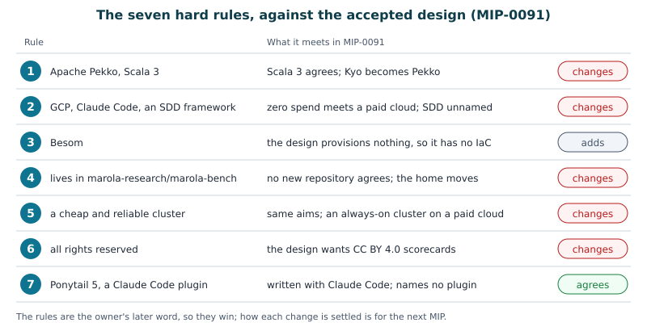

# marola-bench: the design proposal, in pictures

> **Cite this as.** Hoffmann, M. (2026). *marola-bench: a proposal for a WeatherBench for
> Brazil*. Zenodo. <https://doi.org/10.5281/zenodo.23352633>. All rights reserved: read it and
> cite it; do not copy it or share it without the author's acknowledgement.
>
> **What this is.** A preprint that draws section 4 and the hard rules of the marola-bench paper
> ([`paper.md`](paper.md)). It adds no design. A solid box is a hard rule of the owner, or a part
> of the paper's section 4. A dashed box is open: the next MIP decides it. If this preprint and
> the paper disagree, the paper is right. If either disagrees with MIP-0091, the MIP is right
> until the next MIP [@mip0091].
>
> **How to read the marks.** **(v)** means that the claim was checked against its source;
> [`REFERENCES.md`](REFERENCES.md) quotes the passage. **(MIP §n)** means that the claim is the
> design's. **(paper §n)** means that the claim is the paper's own proposal, from that section.
> **⚠** means not checked by anyone yet.

## 1. The bench

> "The bench are the score series performed by any Forecaster, Registered by an Actor." (the
> owner, 13 October 2026)

{width=100%}

- An **observation point** has an instrument, an averaging, a quality flag and a licence tier
  **(MIP R4)**. A person adds it by hand **(paper §4.2)**.
- A **forecaster** is a provider's model today, and marola's own forecaster later. Each one is
  scored by the same rule **(paper §4.1)**.
- A score that is registered is never edited. A new version of the protocol starts new series
  **(MIP R2)**. A missing observation is a row that says "missing", never a model's value
  **(MIP R4)**.

## 2. The system

{width=100%}

- The CRUD API is specified in Apache Pekko and Scala **(paper §4.2)**. Pekko HTTP is "a full
  server- and client-side HTTP stack on top of pekko-actor and pekko-stream" [@pekkohttp]
  **(v)**.
- One actor for each point. An actor with nothing to do is stopped and started again when it is
  needed: Pekko calls this passivation, and by default an idle entity is passivated after 2
  minutes [@pekkosharding] **(v)**.
- The cluster runs on GCP (hard rule 2), in Scala 3 and Pekko (hard rule 1). Its infrastructure
  is code in Besom (hard rule 3) [@besom] **(v)**.
- Open: where the events are stored, which GCP products run the nodes, how many nodes, and the
  budget in money **(paper §4.4)** **⚠**.

## 3. The life of a point's actor

{width=100%}

The actor monitors its point, asks the providers, later asks marola's forecaster, and registers
each score **(paper §4.3)**. The order of steps 3 and 4 in the figure is a drawing, not a
decision. Two of the paper's proposals for the next MIP show in it **(paper §4.4)**:

- **State is events.** The actor stores what happened and builds its state from that. Pekko
  recovers such an actor "by replaying the stored events", also when it is "migrated within a
  cluster" [@pekkopersistence] **(v)**.
- **Every write can be repeated.** After a restart the actor may do its last step again. A
  score registered two times is one score.

## 4. Reliability is what makes it cheap

{width=100%}

On GCP, "Compute Engine might preemptively stop or delete (preempt) Spot VMs to reclaim the
capacity at any time", and Spot VMs have "significant discounts" [@gcpspot] **(v)**. A cluster
that survives the loss of a node can use them. So the two halves of hard rule 5 are one piece of
work: first survive the loss of any node, then buy the nodes that can be taken away
**(paper §4.4)**.

When nodes cannot see each other, both sides must "take the same decision about which part will
keep running". Pekko's Split Brain Resolver has five strategies, and keep majority is the
default [@pekkosbr] **(v)**. Which one marola-bench uses is open **⚠**.

## 5. The seven hard rules

{width=100%}

The rules are in the paper, with what each one meets **(paper, "Hard rules")**. Rule 7 is of 14
October 2026: Ponytail 5 is the coding assistant, a Claude Code plugin [@ponytail] **(v)**. It
agrees with MIP-0091, which was written with Claude Code and names no plugin **(MIP header)**.
Rule 3 is drawn as "adds", not "changes": the design provisions nothing, so it has no
infrastructure as code to change **(MIP R17)**.

## 6. How a change is made

{width=100%}

- A design change is written in a MIP in `marola-dev/marola` first. A paper gives an account of
  a design; it does not make one (this repository's `AGENTS.md`, rule 6) **(v)**.
- Ponytail's skill takes "the smallest change that fully solves the task" **(v)**. Its skill
  file does not mention a specification **(v)**. So it does not fill rule 2's SDD framework, and
  where that framework sits in the chain is open **⚠**. This is the writer's reading.
- The owner merges. An agent never merges and never releases (`AGENTS.md`, rule 7) **(v)**.

## 7. What is not known

- Every dashed box: the event store, the GCP products, the number of nodes, the strategy of the
  Split Brain Resolver, the budget in money, and the SDD framework **⚠**.
- Whether Pekko and the Kyo module of the accepted design live together, or one replaces the
  other **(paper, "Hard rules")**.
- How the actors and the four-hour cycle of today meet **(MIP §5.2)**.
- What Ponytail changes in this work. Its page reports numbers from its author's benchmark, and
  nobody has measured them on marola-bench, which has no code yet **⚠**.

## 8. Where this comes from

The paper [`paper.md`](paper.md), its section 4 and its hard rules, read on 14 October 2026. The
design, MIP-0091 at commit `cf7bd4f` [@mip0091]. The figures were drawn for this preprint, as
SVG files in [`figures/`](figures/); they copy no other figure.

## References

How each entry was checked is in [`REFERENCES.md`](REFERENCES.md).

::: {#refs}
:::
